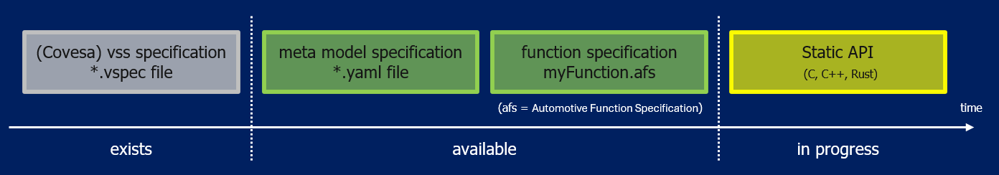

..
   # *******************************************************************************
   # Copyright (c) 2026 Contributors to the Eclipse Foundation
   #
   # See the NOTICE file(s) distributed with this work for additional
   # information regarding copyright ownership.
   #
   # This program and the accompanying materials are made available under the
   # terms of the Apache License Version 2.0 which is available at
   # https://www.apache.org/licenses/LICENSE-2.0
   #
   # SPDX-License-Identifier: Apache-2.0
   #
   # Contributors:
   #   Thomas Pfleiderer
   #   Saran Gundlapalli
   # *******************************************************************************

Current status of the project

Meta Model
==========

The meta model defines middleware-independent metadata for the definition and
generation of standardized function APIs. Catalogue/interface metadata, for
example metadata originating from COVESA VSS or an extended catalogue, is
separated from function-specific configuration and runtime state where
applicable.

The current core interface types are **Data**, **Parameter**, **Scheduling**,
and a candidate **Error** interface. The model also defines common enumerations,
runtime companion information for data quality, execution-result semantics, and
cross-cutting modelling rules.

For Data and Parameter interfaces, ``name`` is the unique interface identifier
and contains the fully qualified hierarchical identifier. The hierarchy remains
part of the VSS/catalogue semantics; it is carried by ``name`` rather than
duplicated in a second ``path`` property.

Enum Type Description
---------------------

The meta model defines common enum types used by interface properties and
runtime information.

.. list-table:: Meta Model Enum Types
   :header-rows: 1
   :widths: 20 45 35

   * - **Enum**
     - **Values**
     - **Purpose**
   * - ASIL
     - ``QM``, ``A``, ``B``, ``C``, ``D``
     - Safety classification used where an interface or runnable is safety-relevant.
   * - DataQuality
     - ``uninitialized``, ``invalid``, ``valid``
     - Runtime qualifier values. ``qualityCode`` is runtime information and is not a static Data property value.
   * - Direction
     - ``input``, ``output``
     - Function-relative direction of a Data interface.
   * - RunType
     - ``init``, ``cyclic``, ``event``, ``terminate``
     - Activation type of a runnable.
   * - FunctionResult
     - ``success``, ``failure``, ``notAvailable``
     - Generic execution result only. It does not encode function-specific diagnostic causes.
   * - ErrorSeverity
     - ``information``, ``warning``, ``degraded``, ``shutdown``
     - Functional impact/severity associated with a function-specific Error interface.
   * - SupervisionType
     - ``none``, ``alive``, ``deadline``, ``logical``, ``combined``
     - Types of runnable execution supervision represented by the meta model.

FunctionResult
~~~~~~~~~~~~~~

``FunctionResult`` represents the generic outcome of an execution. It shall be
limited to ``success``, ``failure``, or ``notAvailable`` and shall not replace
function-specific diagnostic/error interfaces.

An adapter may report a failure it can observe, for example an invocation,
transport, or timeout failure. It shall not synthesize detailed
function-internal diagnostic causes or use ``FunctionResult`` as fault-logging
information.

Data Type Description
---------------------

**Standard Naming Convention:** ``Vehicle.<Domain/Subdomains>.<Signal>``

``name`` contains the fully qualified VSS node identifier, including its
hierarchical path, for example ``Vehicle.Speed``. The metamodel therefore does
not duplicate this identifier in an additional ``path`` property.

.. list-table:: Meta Model Data Type
   :header-rows: 1
   :widths: 18 12 16 42 22

   * - **Property / Attribute**
     - **Req.**
     - **Datatype**
     - **Description**
     - **Example / Notes**
   * - name
     - Yes
     - string
     - Unique interface or node name containing the fully qualified VSS node identifier, including its hierarchical path.
     - ``Vehicle.Speed``
   * - dataType
     - Yes
     - string
     - Type of value transported by the interface.
     - ``float``, ``uint8``, ``uint16``, ``boolean``
   * - description
     - Yes
     - string
     - Functional meaning of the Data interface.
     - Vehicle longitudinal speed
   * - unit
     - Yes
     - string
     - Engineering unit of the Data interface.
     - ``km/h``
   * - min
     - Yes
     - number
     - Engineering minimum representable value. ``null`` if not yet defined or not applicable.
     - ``0``
   * - max
     - Yes
     - number
     - Engineering maximum representable value. ``null`` if not yet defined or not applicable.
     - ``300``
   * - defaultValue
     - Yes
     - any
     - Default or initialization value, where defined. ``null`` if not yet defined or not applicable.
     - ``0``
   * - resolution
     - Yes
     - number
     - Smallest measurable quantization value, for example for scaling.
     - ``0.1``
   * - precision
     - Yes
     - number
     - Required numeric precision or number of meaningful digits.
     - ``0.01``
   * - FuSa
     - Yes
     - boolean
     - Indicates whether the Data interface is safety-relevant.
     - ``true`` / ``false``
   * - ASIL
     - No
     - enum: ASIL
     - Safety classification associated with the Data interface when it is safety-relevant.
     - ``QM`` / ``A`` / ``B`` / ``C`` / ``D``
   * - minUpdatePeriodMs
     - Yes
     - uint16
     - Minimum interval between Data updates in milliseconds.
     - ``10``
   * - accuracy
     - Yes
     - string
     - Expected measurement or estimation accuracy.
     - ``±0.2 km/h``
   * - direction
     - Yes
     - enum: Direction
     - Defines the direction of the interface relative to the function/application being specified. ``input`` means the function consumes the data; ``output`` means the function provides the data. This is independent of the VSS sensor/actuator classification.
     - ``input`` / ``output``
   * - protectionRequired
     - Yes
     - boolean
     - Indicates whether protection is required for transfer of the Data between the function and its platform environment. The technical realization is platform-dependent and outside the scope of the metamodel/application specification.
     - ``true`` / ``false``

Runtime Data Quality
~~~~~~~~~~~~~~~~~~~~

``qualityCode`` is runtime companion information and is intentionally separated
from the static Data metadata.

.. list-table:: Data Runtime Companion
   :header-rows: 1
   :widths: 20 18 20 42

   * - **Property**
     - **Datatype**
     - **Generation**
     - **Description**
   * - qualityCode
     - enum: DataQuality
     - Separate runtime information
     - Runtime quality/validity information accompanying the Data value. Recommended naming is ``<DataPath>.Qualifier``, for example ``Vehicle.Speed.Qualifier``.

A static function specification shall therefore not contain a constant such as
``qualityCode: valid`` as if it were immutable interface metadata.

Parameter Type Description
--------------------------

**Standard Naming Convention:** ``Vehicle.<Domain/Subdomains>.<Parameter>``

``name`` contains the complete canonical parameter identifier, including its
hierarchical path. The metamodel therefore does not duplicate this identifier in
an additional ``path`` property.

.. list-table:: Meta Model Parameter Type
   :header-rows: 1
   :widths: 18 12 18 42 20

   * - **Property / Attribute**
     - **Req.**
     - **Datatype**
     - **Description**
     - **Example / Notes**
   * - name
     - Yes
     - string
     - Unique parameter identifier following the canonical VSS-style hierarchy, including its hierarchical path.
     - ``Vehicle.Brake.Gain``
   * - dataType
     - Yes
     - string
     - Datatype of the parameter value.
     - ``float``, ``float[]``, ``uint8``, ``boolean``
   * - defaultValue
     - Yes
     - any
     - Default parameter value.
     - ``1.0``
   * - description
     - Yes
     - string
     - Meaning and intended usage of the parameter.
     - Gain for a calibration map
   * - unit
     - Yes
     - string
     - Engineering unit where applicable.
     - ``bar``
   * - tunable
     - Yes
     - boolean
     - Indicates whether the parameter may be tuned/configured after definition.
     - ``true`` / ``false``
   * - min
     - Yes
     - number
     - Minimum permitted parameter value, if defined/applicable.
     - ``null`` where not defined/applicable
   * - max
     - Yes
     - number
     - Maximum permitted parameter value, if defined/applicable.
     - ``null`` where not defined/applicable
   * - dimensions
     - No
     - array shape
     - Shape of an array/map parameter. Omitted for scalars.
     - ``[10]`` for a vector, ``[7, 10]`` for a 7x10 map

Scheduling Type Description
---------------------------

**Standard Naming Convention:** ``<FunctionName>.Init``,
``<FunctionName>.Step``, ``<FunctionName>.Terminate``

Scheduling defines the lifecycle, activation, timing, and execution-supervision
contract of a runnable.

.. list-table:: Meta Model Scheduling Type
   :header-rows: 1
   :widths: 22 14 20 44 22

   * - **Property / Attribute**
     - **Req.**
     - **Datatype**
     - **Description**
     - **Example / Notes**
   * - functionName
     - Yes
     - string
     - Runnable or callable function name.
     - ``LSDC.Step``
   * - runType
     - Yes
     - enum: RunType
     - Activation type of the runnable.
     - ``init``, ``cyclic``, ``event``, ``terminate``
   * - description
     - Yes
     - string
     - Purpose and execution intent of the runnable.
     - Main cyclic calculation
   * - cycleTimeMs
     - Conditional
     - number
     - Periodicity of cyclic execution in milliseconds.
     - Required when ``runType == cyclic``
   * - implementedASIL
     - Yes
     - enum: ASIL
     - ASIL level for which this runnable/execution is implemented.
     - ``QM`` / ``A`` / ``B`` / ``C`` / ``D``
   * - previousRunnableRef
     - No
     - string
     - Runnable that must precede this runnable when an ordering constraint exists.
     - ``SensorFusion.Step``
   * - schedulingPolicy
     - No
     - string
     - Scheduling mechanism or constraint.
     - ``preemptive`` / ``non-preemptive``
   * - supervision
     - Yes
     - object
     - Defines whether execution supervision is required and which supervision types/configuration apply.
     - See `Execution Supervision`_
   * - stackSizeBytes
     - No
     - uint32
     - Required stack size when relevant for deployment/integration.
     - Platform/deployment-specific
   * - executionResult
     - Yes
     - enum: FunctionResult
     - Generic result returned/reported for function execution.
     - ``success`` / ``failure`` / ``notAvailable``

Execution Supervision
~~~~~~~~~~~~~~~~~~~~~

The supervision object indicates whether runtime execution monitoring is
required. If supervision is required, one or more monitoring types are selected
and the corresponding configuration is supplied.

.. list-table:: Scheduling Supervision
   :header-rows: 1
   :widths: 26 16 18 40

   * - **Property**
     - **Req.**
     - **Datatype**
     - **Description**
   * - supervision.required
     - Yes
     - boolean
     - Indicates whether execution supervision is required for the runnable.
   * - supervision.type
     - Conditional
     - enum[]
     - Required when ``supervision.required == true``. The current property values are ``alive``, ``deadline``, and ``logical``.
   * - supervision.alive
     - Conditional
     - object
     - Required when ``type`` contains ``alive``. Supports ``minIndications``, ``maxIndications``, and ``referenceCycleMs``.
   * - supervision.deadline
     - Conditional
     - object
     - Required when ``type`` contains ``deadline``. Uses mandatory ``maxExecutionTimeMs``.
   * - supervision.logical
     - Conditional
     - object
     - Required when ``type`` contains ``logical``. Supports ``predecessorRefs`` and ``successorRefs``.

Alive Supervision
^^^^^^^^^^^^^^^^^

.. list-table:: Alive Supervision Properties
   :header-rows: 1
   :widths: 30 20 18 32

   * - **Property**
     - **Req.**
     - **Datatype**
     - **Description**
   * - minIndications
     - No
     - uint32
     - Minimum expected number of alive indications within the reference cycle. This is not a lower tolerance margin.
   * - maxIndications
     - No
     - uint32
     - Maximum allowed number of alive indications in the reference cycle.
   * - referenceCycleMs
     - No
     - number
     - Reference cycle used to evaluate alive indications.

Deadline Supervision
^^^^^^^^^^^^^^^^^^^^

Deadline supervision verifies that execution completes within the configured
maximum execution-time limit.

.. list-table:: Deadline Supervision Properties
   :header-rows: 1
   :widths: 30 20 18 32

   * - **Property**
     - **Req.**
     - **Datatype**
     - **Description**
   * - maxExecutionTimeMs
     - Yes
     - number
     - Maximum allowed execution time for deadline supervision.

Logical Supervision
^^^^^^^^^^^^^^^^^^^

.. list-table:: Logical Supervision Properties
   :header-rows: 1
   :widths: 30 20 18 32

   * - **Property**
     - **Req.**
     - **Datatype**
     - **Description**
   * - predecessorRefs
     - No
     - string[]
     - References to runnables expected before the supervised runnable.
   * - successorRefs
     - No
     - string[]
     - References to runnables expected after the supervised runnable.

.. note::

   The top-level ``SupervisionType`` enum additionally contains ``none`` and
   ``combined``. The current ``supervision.type`` property in the YAML directly
   lists ``alive``, ``deadline``, and ``logical``.

Error Type Description
----------------------

The Error interface is currently marked as **candidate**. It is a lightweight
function-specific error/status interface, separated from the generic
``FunctionResult``. This candidate model does not redefine DSM/DTC or
event-memory handling. It conveys application-level error/status information
that can be consumed by relevant middleware or platform components for
diagnostic handling and logging. Optional diagnostic metadata may be provided
where required to support downstream diagnostic configuration during
integration.

**Standard Naming Convention:**
``<FunctionName>.<ErrorName>.ErrorStatus``

.. list-table:: Candidate Meta Model Error Type
   :header-rows: 1
   :widths: 24 14 20 42 22

   * - **Property / Attribute**
     - **Req.**
     - **Datatype**
     - **Description**
     - **Example / Notes**
   * - name
     - Yes
     - string
     - Function-specific Error interface name.
     - ``WheelSpeedCalc.RangeError.ErrorStatus``
   * - dataType
     - Yes
     - string
     - Datatype of the exposed Error interface.
     - ``boolean`` / ``enum``
   * - description
     - Yes
     - string
     - Meaning of the Error and its trigger scenario.
     - Range error due to implausible input
   * - severity
     - No
     - enum: ErrorSeverity
     - Optional functional impact/severity associated with the Error, when required for downstream diagnostic configuration.
     - ``warning`` / ``degraded`` / ``shutdown``
   * - maturationTimeMs
     - Yes
     - number (ms)
     - Time for which the Error condition must persist before it is considered matured to be set, when required by the diagnostic/integration concept.
     - ``100``
   * - resetTimeMs
     - Recommended
     - number
     - Optional de-maturation/reset time before clearing the Error, when required by the diagnostic/integration concept.
     - ``200``
   * - resetCondition
     - Recommended
     - string
     - Optional condition that clears the Error, when required by the diagnostic/integration concept.
     - Input valid for a defined duration
   * - dependencyRefs
     - No
     - string[]
     - Optional references to related upstream Error interfaces that may propagate/trigger this Error, when required for integration.
     - ``<SensorTimeout>.ErrorStatus``
   * - fallbackBehavior
     - No
     - string
     - Optional function-level fallback/degradation behavior associated with the Error.
     - ``use_substituted_value``
   * - raisesSafetyReactionRefs
     - No
     - string[]
     - Optional references to safety reactions associated with this Error.
     - ``<SafetyCondition>.SafetyConditionStatus``

Modeling Rules
--------------

The following cross-cutting rules apply to the meta model.

.. list-table:: Meta Model Rules
   :header-rows: 1
   :widths: 15 85

   * - **Rule**
     - **Definition**
   * - MR-001
     - VSS sensor/actuator type and function input/output direction are different concepts. Direction shall be assigned per function-interface usage.
   * - MR-002
     - Runtime quality shall not be populated as a static constant in a function specification. Quality information shall be transported/represented at runtime.
   * - MR-003
     - Generic ``FunctionResult`` shall be limited to execution outcome and shall not replace function-specific diagnostic/error interfaces.
   * - MR-004
     - The metamodel specifies whether protection is required for an interface. The technical realization of that protection is platform-dependent and outside the scope of the metamodel/application specification; it may be provided by the operating system, middleware, communication stack, or other platform mechanisms and shall be configured/enabled/implemented during integration.
   * - MR-005
     - Unknown metadata shall remain ``null`` according to the consuming schema/tool and shall not be replaced with invented plausible values.

Meta Model File
---------------

Version 0.4.1

.. literalinclude:: autoapiframework_metadata_V04.yaml
   :language: yaml
   :linenos:

History
-------

.. list-table:: Meta Model History
   :header-rows: 1
   :widths: 15 22 43 20

   * - **Version**
     - **Author**
     - **Description of Changes**
     - **Impact**
   * - 0.2.0
     - Gundlapalli Saran
     - First release of Meta Model specification.
     - Baseline
   * - 0.3.0
     - Thomas Pfleiderer
     - Signal protection attribute, FunctionResult enum, and typo corrections.
     - Functional enhancement
   * - 0.4
     - Gundlapalli Saran
     - Updated Data and Parameter metadata; separated runtime quality information; moved function-relative direction/protection requirement to Data; added FuSa handling, execution supervision, generic execution-result semantics, candidate Error interface, and modelling rules.
     - Architectural and functional enhancement
   * - 0.4.1
     - Gundlapalli Saran
     - Incorporated review feedback from Bosch: replaced the protection mechanism enum with the boolean ``protectionRequired`` requirement; clarified VSS hierarchical naming and function/application-relative ``direction`` semantics; clarified ``minIndications`` semantics for alive supervision; removed ``minExecutionTimeMs`` from deadline supervision; refined the candidate Error interface and its downstream diagnostic-integration purpose; and reworded MR-004 to keep protection realization platform-dependent and outside the metamodel/application specification.
     - Review-driven clarification and simplification

Examples
--------

Example function specifications based on this meta model:

- :download:`SpeedHazardDetection (single cyclic runnable) <../function_specification/examples/speed_hazard_detection.afs.yaml>`
- :download:`VehicleSpeedFusion (multi-rate cyclic runnables at 10 ms and 20 ms) <../function_specification/examples/vehicle_speed_fusion_multirate.afs.yaml>`
